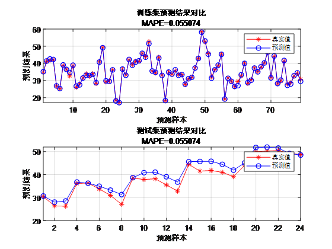
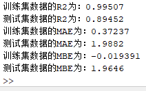

# Adaboost-BP neural network regression prediction algorithm, which can be used as a deep learning comparison prediction model to enrich experimental content, with built-in dataset, directly run!

Applicable Platforms: MATLAB 2021 and Above
Adaboost-BP is an ensemble learning method that combines the principles of Adaboost and Back Propagation (BP) neural networks. Adaboost is a boosting algorithm that improves the overall model performance by integrating multiple weak predictors (usually simple learners). BP neural networks are a common type of artificial neural network used to model and learn complex nonlinear relationships.

The following is the principle of Adaboost-BP:

Adaboost Principle:
The core idea of Adaboost is to iteratively train a series of weak predictors and assign weights to each predictor to adjust its contribution in the final model.
In each iteration, Adaboost adjusts the weight of training samples to give more attention to previously classified incorrect samples in the next round.
Ultimately, the predictions of all weak predictors are summed up to obtain the output of the final model.

BP Neural Network Principle:
BP neural networks are a type of feedforward neural network consisting of an input layer, hidden layers (which can have multiple layers), and an output layer.
The neural network calculates the output through forward propagation, then adjusts the weights through backpropagation to minimize prediction errors.
Backpropagation uses gradient descent to update weights by calculating the derivative of the loss function with respect to the weights.
Combination of Adaboost-BP:
In Adaboost-BP, each iteration uses a BP neural network as a weak predictor.
Initially, all sample weights are equal.
During each training round, the current sample weight is used to train the BP neural network, and the network's performance (predictive accuracy) is used to adjust the weights.
After training one BP neural network, the weight of that network in the overall model is calculated, and the sample weights are updated so that more attention is given to previously predicted with low accuracy samples in the next round.
This process is repeated until the specified number of iterations or the model performance meets certain requirements.
Final Model Predictions:
The final model is a weighted combination of all weak predictors, with the weights determined by their performance during training. 
During prediction, the final model output is obtained by summing the predictions of each weak predictor with corresponding weights.
Adaboost-BP's advantage lies in its integration of Adaboost and neural network strengths, enabling it to better handle complex nonlinear relationships and enhance generalization capabilities of the model. However, it should also be noted that this method may be more complex and time-consuming during training.
Programmatic Prediction Results:
\n        \n      \n        \n

## Images

<!-- PAYMENT_BLOCK -->

## Get this dataset

- Payment link (Stripe): [Buy now](https://buy.stripe.com/3cs8yP7sY87d0vu9AB)
- Payment QR code: 

<!-- /PAYMENT_BLOCK -->
